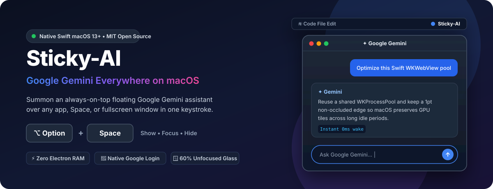

<div align="center">



# Sticky-AI — Native Google Gemini Desktop & Menu Bar App for macOS

**Summon an always-on-top floating Google Gemini assistant anywhere on macOS with `Option + Space` (`⌥ + Space`).**

[](https://github.com/madmicrowave/sticky-ai/actions/workflows/ci.yml)
[-000000?logo=apple&logoColor=white)](https://github.com/madmicrowave/sticky-ai)
[](https://gemini.google.com)
[](https://swift.org)
[](./LICENSE)
[](https://domonk.com)

[**Quick Install**](#installation--quick-start) • [**Why Sticky-AI?**](#why-sticky-ai) • [**Shortcuts**](#keyboard-shortcuts--menu-bar-controls) • [**FAQ**](#frequently-asked-questions-faq) • [**DOMONK Factory**](https://domonk.com)

</div>

---

**Sticky-AI** is a lightweight, zero-dependency, **native macOS desktop and menu bar app for Google Gemini** (`https://gemini.google.com/app`), open-sourced under the MIT License by **[DOMONK Factory](https://domonk.com)**.

Press **`Option + Space` (`⌥ + Space`)** from **anywhere on your Mac** — over Xcode, VS Code, Antigravity IDE, Terminal, Desktop Spaces, or full-screen apps — to toggle a compact floating Google Gemini window with instant prompt auto-focus, smart `60%` translucency while unfocused, native Google Passkey/OAuth sign-in, and one-click file downloads to `~/Downloads`.

---

## Why Sticky-AI?

| Capability | Sticky-AI (Native Swift) | Browser Tab | Electron / CEF Wrappers |
| :--- | :--- | :--- | :--- |
| **Global `Option + Space` Shortcut** | ✅ Instant across all Spaces & fullscreen apps | ❌ Must hunt tabs/windows | ⚠️ Often requires Accessibility permissions |
| **Google Account Sign-In & Passkeys** | ✅ Native Apple `WKWebView` (never blocked) | ✅ Works | ❌ Frequently blocked by Google security check |
| **Idle Memory & Binary Size** | ✅ Tiny native Swift binary (`AppKit` + `WebKit`) | ⚠️ Lost among 50+ tabs | ❌ 250 MB+ bundled Chromium runtime |
| **Always-on-Top Translucent Reference** | ✅ `100%` focused / `60%` see-through unfocused | ❌ Covers your editor | ⚠️ Varies |
| **Instant Open After Hours Idle** | ✅ Zero black-flash GPU tile & DOM retention | ⚠️ Tab discarding | ❌ Blank re-render delay |

---

## Key Features

1. **Dedicated Native macOS Window for Google Gemini (`https://gemini.google.com/app`)**
   - Lives quietly in the macOS menu bar (`LSUIElement`, zero `Cmd + Tab` or Dock clutter) with persistent `WKWebsiteDataStore` storage so your Google account stays signed in across hides and reboots.
   - **Zero-Black-Screen Instant Open**: Soft-hides using a click-through, shadowless `1pt` edge keep-alive + App Nap prevention + cached snapshot shield + sleep-wake recovery so macOS `WebKit` never purges GPU `IOSurface` tiles or drops your live Gemini DOM even after hours idle.
2. **Global `Option + Space` (`⌥ + Space`) Hotkey Anywhere on macOS**
   - Registered directly with the macOS WindowServer via Carbon `HIToolbox` (`RegisterEventHotKey`), working across every app, Desktop Space, and full-screen window **without requiring Accessibility permissions**.
3. **3-State Focus, Translucency & Hide Cycle**
   - **Hidden + `Option + Space`** → Appears **on top of all windows**, activates Sticky-AI at **`100%` opacity**, and **auto-focuses the Google Gemini prompt input** ready to type.
   - **Visible & Unfocused** → Remains pinned **on top of all windows** at configurable translucency (**`60%` opacity / `40%` transparent** by default) so you can read code or docs behind Gemini's answer.
   - **Visible & Unfocused + `Option + Space`** (or mouse click) → Restores **`100%` opacity** and focuses the Google Gemini message input.
   - **Visible & Focused + `Option + Space`** → **Hides Sticky-AI** immediately and restores keyboard focus to the exact external app you were using before.
4. **Compact, Movable & Multi-Display Aware**
   - Opens at a compact `420 × 560` floating panel near the top-right of your active display (`min 280 × 320`).
   - Remembers your custom window position, size, and unfocused transparency in `~/Library/Application Support/Sticky-AI/sticky-ai-config.json`, clamping cleanly onto visible screens when monitors connect or disconnect.
5. **Seamless One-Click Downloads to `~/Downloads`**
   - Clicking **Download** on generated Google Gemini images, code archives, PDFs, or exports saves directly to `~/Downloads` (inferring MIME extensions automatically and numbering duplicates as `file (1).png`, `file (2).png` without overwriting).

---

## Installation & Quick Start

### Option A — Download Prebuilt `Sticky-AI.app` (macOS 13+)

Check the [**GitHub Releases**](https://github.com/madmicrowave/sticky-ai/releases) page to download `Sticky-AI-macOS.zip`, unzip it, drag **`Sticky-AI.app`** into `/Applications`, and launch it.

### Option B — One-Command Build from Source (Xcode Command Line Tools)

Requires **macOS 13.0 (Ventura) or newer** (Apple Silicon `M1`/`M2`/`M3`/`M4` & Intel) and `xcode-select --install`:

```bash
git clone https://github.com/madmicrowave/sticky-ai.git && cd sticky-ai && zsh scripts/build-app.sh && cp -R ./Sticky-AI.app /Applications/ && open /Applications/Sticky-AI.app
```

*(Or inside the repo with npm: `npm start` builds `Sticky-AI.app` automatically if needed and launches it.)*

---

## First-Time Google Gemini Sign-In

1. Launch `Sticky-AI.app` (or press **`Option + Space`**).
2. Click **Sign in** inside the Google Gemini window and complete your normal Google authentication (including Passkeys / 2-Step Verification).
3. Cookies and session state are stored persistently in macOS `WKWebsiteDataStore` — Google Gemini stays signed in across window toggles and macOS restarts.

### Start Automatically at macOS Login (Optional)

1. Open **System Settings → General → Login Items & Extensions**.
2. Under **Open at Login**, click **`+`**, select `/Applications/Sticky-AI.app`, and click **Open**.

---

## Keyboard Shortcuts & Menu Bar Controls

Click the **Sticky-AI** icon in the top-right macOS menu bar at any time:

| Action | Shortcut / Menu Item |
| :--- | :--- |
| **Show / Focus / Hide Sticky-AI** | `Option + Space` (`⌥Space`) — global across macOS |
| **Focus Google Gemini Input** | Menu Bar → *Focus Message Input* |
| **Open Gemini Home** | Menu Bar → *Open Gemini Home* (`https://gemini.google.com/app`) |
| **Reload Page** | `Cmd + R` |
| **Reset Window Size & Position** | Menu Bar → *Reset Window Size & Position* |
| **Unfocused Opacity Presets** | `80%`, `60% (Default)`, `40%`, `20%` |
| **About (`DOMONK Factory`)** | Menu Bar → *About* (opens **DOMONK Factory** info & link to [https://domonk.com](https://domonk.com)) |
| **Quit Sticky-AI** | `Cmd + Q` |

### Optional Environment Overrides

- `STICKY_AI_UNFOCUSED_OPACITY`: Float between `0.05` and `1.0` (e.g. `0.5`) overriding unfocused window alpha.
- `STICKY_AI_DOWNLOADS_DIR`: Custom directory path for downloaded Gemini assets (defaults to `~/Downloads`).

---

## Frequently Asked Questions (FAQ)

<details>
<summary><b>Is there a native Google Gemini desktop app for macOS?</b></summary>
<br />
Google does not currently ship a standalone native macOS desktop app for Gemini. <b>Sticky-AI</b> fills that gap with a tiny, 100% open-source native Swift (<code>AppKit</code> + <code>WebKit</code>) menu bar and Spotlight-style <code>Option + Space</code> floating window.
</details>

<details>
<summary><b>Why does Google Sign-In work in Sticky-AI when Electron wrappers say "This browser or app may not be secure"?</b></summary>
<br />
Sticky-AI uses Apple's native system <code>WKWebView</code> engine rather than an embedded Chromium/Electron debugging frame, so standard Google Account sign-in, 2FA, and Passkeys work seamlessly.
</details>

<details>
<summary><b>Does Sticky-AI require macOS Accessibility or Input Monitoring permissions?</b></summary>
<br />
No. Sticky-AI registers <code>Option + Space</code> using macOS Carbon <code>RegisterEventHotKey</code>, which works system-wide without broad keystroke-monitoring permissions.
</details>

---

## Architecture & Project Structure

```text
sticky-ai/
├── Package.swift                              # Swift Package Manager manifest (macOS 13+)
├── Sources/
│   ├── StickyAICore/
│   │   ├── StickyAppController.swift          # Floating NSPanel, WKWebView session, OAuth popups & menu bar UI
│   │   ├── StateMachine.swift                 # 3-state Option+Space transition logic, opacity & ConfigStore
│   │   ├── HotKeyManager.swift                # Carbon HIToolbox global Option+Space hotkey registration
│   │   ├── FocusInput.swift                   # Resilient DOM prompt-input auto-focus & caret placement
│   │   └── DownloadHelper.swift               # MIME extension inference, filename sanitization & unique ~/Downloads paths
│   └── StickyAIApp/
│       └── main.swift                         # Native macOS NSApplication entrypoint
├── Resources/                                 # AppIcon.icns & MenuBarIcon.png
├── Tests/
│   └── TestMain.swift                         # Automated test suite for state machine, config, focus & downloads
├── scripts/
│   ├── build-app.sh                           # Standalone `Sticky-AI.app` builder & ad-hoc codesigner
│   └── run-tests.sh                           # Compiles & runs automated Swift test suite
├── assets/
│   └── banner.svg                             # Project hero preview
└── LICENSE                                    # MIT License
```

## Running Automated Tests

```bash
zsh scripts/run-tests.sh
```

*(Or `npm test`)* — Compiles `StickyAICore` with `Tests/TestMain.swift` and verifies the 3-state hotkey state machine, unfocused opacity clamping, multi-screen frame persistence, Google OAuth domain routing, filename sanitization, and collision-free `~/Downloads` resolution.

---

## More Open-Source macOS AI Tools by DOMONK Factory

- **[Mobile Agent Control (`mobile-agent-control` — `mac.app`)](https://github.com/madmicrowave/mobile-agent-control)** — Native macOS menu bar app (`MAC` badge next to your clock) with 2-minute visual setup to remotely control all your local **Google Antigravity (`agy`)** coding Workspaces (Google Gemini & Claude), commit/branch Git changes, and promote Staging → Production Jenkins CI/CD deployments from **Telegram**.

If **Sticky-AI** speeds up your daily macOS workflow, please consider giving the repository a **⭐️ Star on GitHub** so other Mac developers can discover it!

---

## Open Source License & Credits

Released as free and open-source software under the **[MIT License](./LICENSE)**.

**Powered by [DOMONK Factory](https://domonk.com)** — [https://domonk.com](https://domonk.com)
